<p align="center">
  
</p>

<h1 align="center">Etaernal Railway Intelligence</h1>

<p align="center"><strong>Less guessing. More knowing when you’ll arrive.</strong></p>
<p align="center">Train tracking, station-specific arrival explanations and an evaluated arrival-time prediction pilot.<br />Built for Smart India Hackathon problem statement <strong>26028 · Ministry of Railways</strong>.</p>

<p align="center">
  <a href="https://equinox01.vercel.app/dashboard">Open website</a> ·
  <a href="#application-gallery">See the applications</a> ·
  <a href="#eta-prediction-the-core-of-etaernal">Understand the ETA</a> ·
  <a href="docs/development/setup.md">Run locally</a> ·
  <a href="docs/README.md">Documentation</a>
</p>

<p align="center">
  
  
  
  
</p>

Etaernal helps passengers answer three questions: **Where is my train? When
should it reach my station? What supports that estimate?** The Next.js website
and Flutter app share a FastAPI backend, so arrival information follows the same
journey and prediction rules across both experiences.

Our main technical contribution is a genuinely trained arrival-delay model,
evaluated against the previous method on held-out journeys. Its scope is a
**three-train pilot**, with explicit fallback estimates whenever a train or
observation is outside the validated coverage. This is an SIH prototype, not an
official Indian Railways service or a claim of nationwide prediction accuracy.

## Explore

[Application gallery](#application-gallery) · [Problem and solution](#problem-and-solution) ·
[Features](#verified-capabilities) · [ETA system](#eta-prediction-the-core-of-etaernal) ·
[Architecture](#architecture-and-stack) · [Setup](#run-it-locally) ·
[Demo and APK](#demo-deployment-and-mobile-installation) · [Roadmap](#roadmap) ·
[Contributing](#contribution-licence-and-credits)

## Application gallery

Genuine captures of the deployed website and the Android **1.1.9+11** release app. Train
times and data availability reflect the moment of capture, **17 October 2026**.
No API fixtures or fabricated predictions were inserted. See the
[capture record and update guide](docs/screenshots/README.md).

### Website

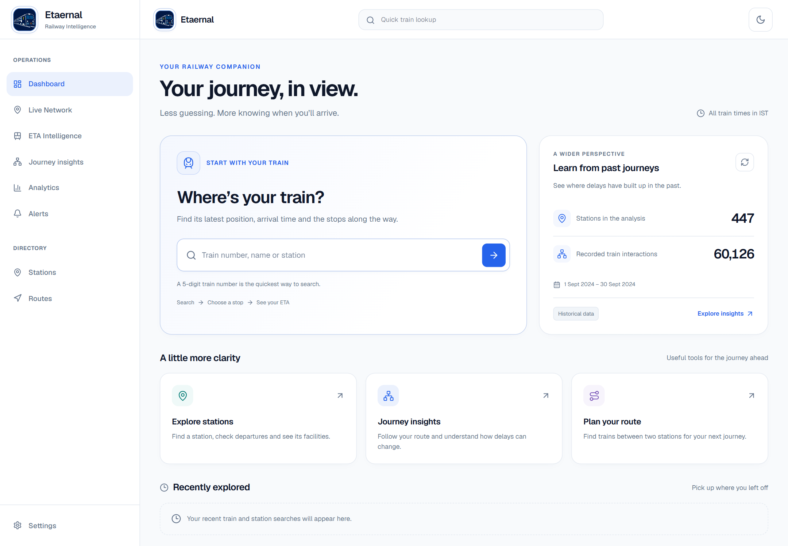

*A passenger-first dashboard: search a train, choose a stop, then see its ETA.*

| Arrival estimates | Your train’s route |
| --- | --- |
| 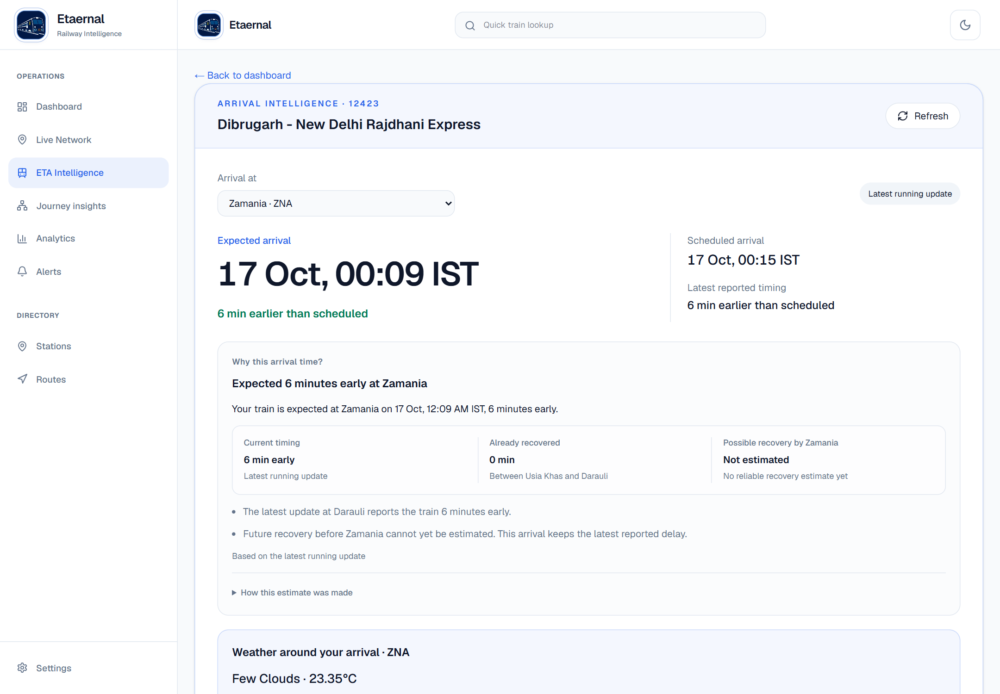 | 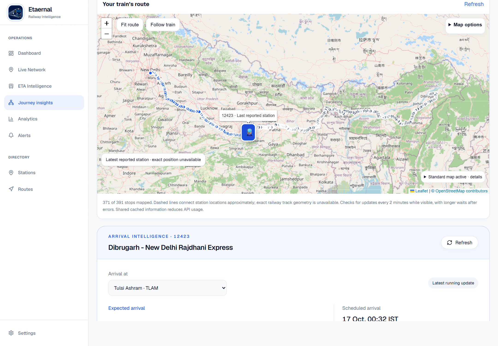 |
| Station-specific arrival explanation. This capture uses the reported-delay fallback, not a trained-model forecast. | Only the selected train is mapped. Approximate station links and missing coordinates are identified. |

| Journey analytics | Route simulation |
| --- | --- |
| 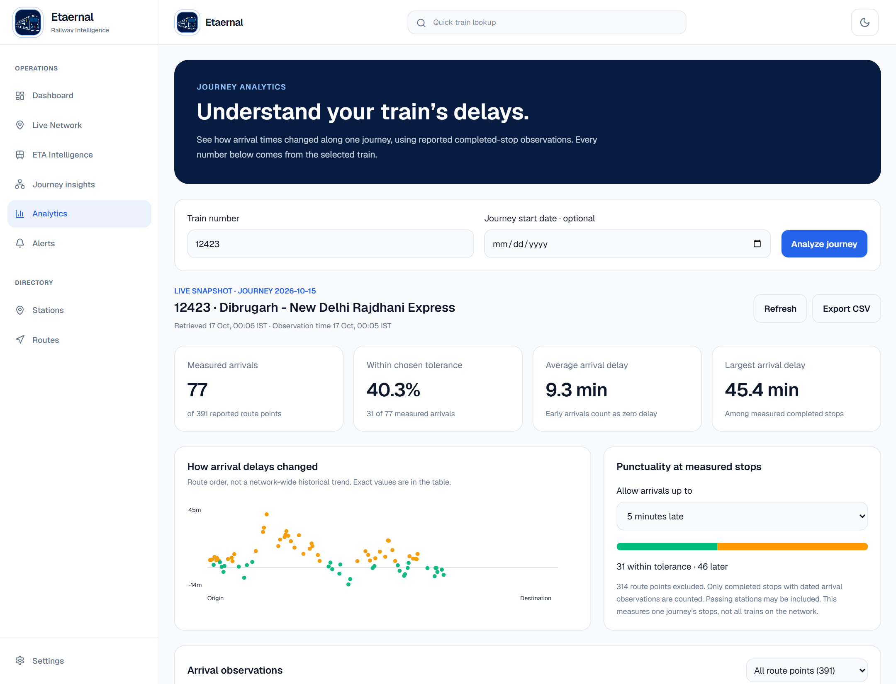 | 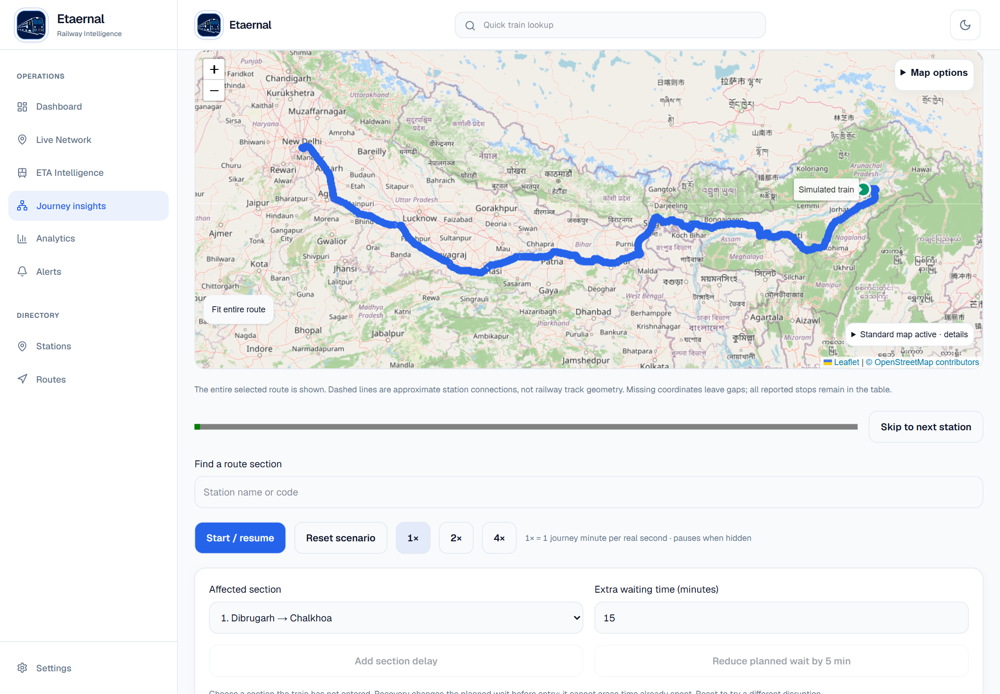 |
| Compare scheduled and reported actual arrivals for one journey. | Explore an explicitly illustrative what-if scenario; it is separate from live tracking. |

<details>
<summary>Train search and historical station insights</summary>

| Train and route search | Past delay patterns |
| --- | --- |
| 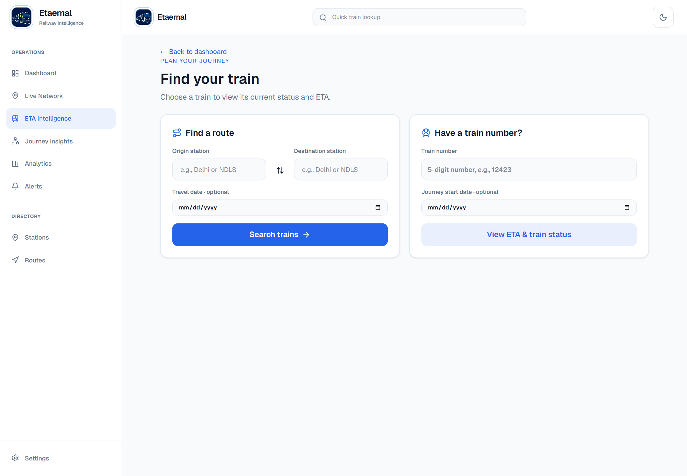 | 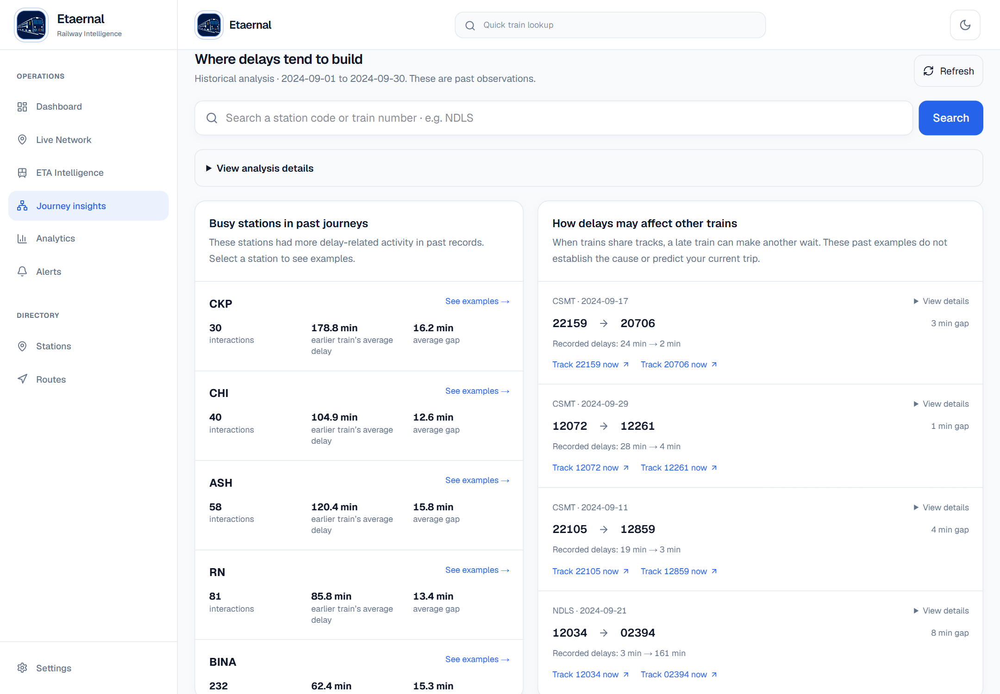 |

</details>

### Android application

| Search and home | Train arrival information | Journey insights |
| --- | --- | --- |
| 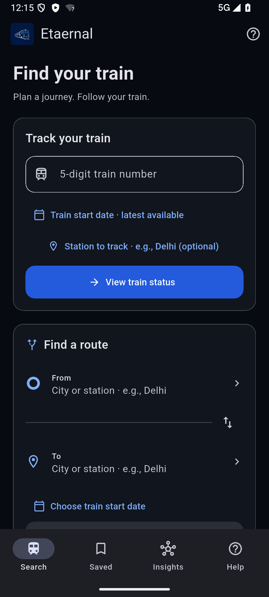 | 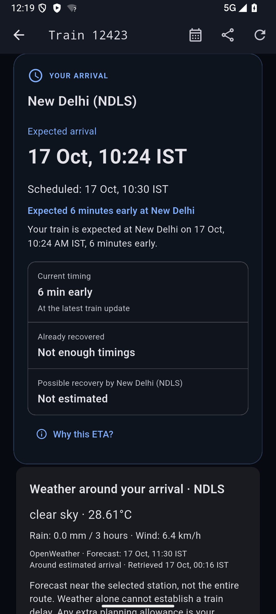 | 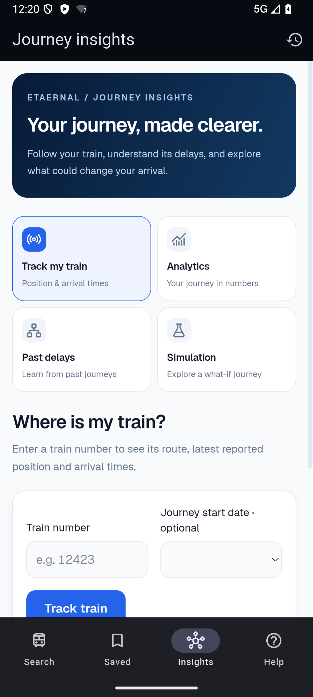 |

The home and train-details screens are native Flutter. Journey insights shares
the deployed web workspace through an Android/iOS WebView, including maps,
analytics, past delays and simulation.

## Problem and solution

A timetable cannot tell passengers whether their train has lost time at the
last stop, recovered time on the route or received a fresh running update.
Simply carrying today's delay to every future station also misses how delays
have changed on comparable past journeys.

Etaernal combines reported train-running information with a trained, scoped ETA
model. It gives passengers a selected-station arrival time, explains the evidence
in plain language and distinguishes measured facts from estimates. The website
provides the wider map and analytics workspace; the mobile app keeps search,
saved journeys and arrival information close at hand.

## Verified capabilities

| Area | Available today | Important boundary |
| --- | --- | --- |
| Find a train | Name/number lookup, station-pair search, journey date selection | Requires provider data or a configured database; missing data is not invented. |
| Follow a journey | Running status, ordered route, intermediate points, selected-train map | Location may be a reported station or an estimated position, rather than verified GPS. |
| Understand arrival | Per-stop ETA, early/late duration, station-specific explanation, measured recovery | Causes and future recovery are stated only when the available evidence supports them. |
| Trained ETA pilot | Gradient-boosted model for **12303, 12423, 12624** | Freshness, station-pair, horizon and feature checks can select the older delay-adjusted method. |
| Journey insights | Selected-journey analytics, CSV export, historical station analysis, route simulation | Historical patterns and simulated movement are kept separate from live observations. |
| Arrival weather | OpenWeather forecast near the selected station | Context only; weather is not a trained model input or a confirmed cause of delay. |
| Mobile essentials | First-run guide, native train search/details, saved journeys, themes, clock-reminder handoff | Saved journeys are local; clock alarms do not automatically change with the ETA. |
| Native ETA feedback | Reports with local pending state, retry and a matching server receipt | Passenger feedback is unverified; it is not a training label or confirmed delay cause. |
| API efficiency | Shared persistent cache, concurrent-request deduplication, date aliases and quota backoff | Provider limits still apply. Cache age and unavailable states remain visible. |

See the [complete implementation/limitation matrix](docs/FEATURE_STATUS.md).

## ETA prediction: the core of Etaernal

### From a running update to an arrival estimate

1. **Collect:** the backend retrieves the selected train and journey date from
   RailRadar, reusing one cached response across status, ETA and weather requests.
2. **Check:** it verifies timestamps, route order, completed station events and
   freshness. A timetable alone is not treated as a live observation.
3. **Build inputs:** confirmed delay, earlier delay trend, train/station identity,
   scheduled time and distance remaining, observed dwell, calendar/time features.
4. **Predict:** eligible stops use fitted gradient-boosted trees to estimate how
   delay will change before arrival. The learned change is added to the observed
   delay and the scheduled arrival.
5. **Fall back honestly:** unsupported observations retain a labelled
   schedule-plus-reported-delay estimate. Without fresh running evidence, the
   interface can show a timetable or unavailable state instead.
6. **Explain and update:** each stop receives its own explanation and recovery
   evidence. Foreground refresh rebuilds the estimate when fresh data arrives;
   the model does not retrain itself on each request.

### Measured historical results

The model was trained with **scikit-learn GradientBoostingRegressor**, not a
renamed rule-based formula. A pinned third-party dataset supplies dated station
events. Whole journeys are split chronologically into fitting, validation,
calibration and final test, with boundary exclusions to reduce leakage.

| Method on the same final-test observations | MAE ↓ | RMSE ↓ |
| --- | ---: | ---: |
| Previous scheduled-arrival + observed-delay method | 18.95 min | 30.01 min |
| **Trained model with its fixed coverage/fallback policy** | **15.39 min** | **27.18 min** |

**18.8% lower average absolute error**, across **229 held-out journeys**, from
2 June to 1 September 2026. MAE is the average size of the arrival-time error;
RMSE gives larger mistakes more weight. The 81,624 station/target examples are
correlated observations, not 81,624 independent journeys.

These are retrospective third-party station-event results, **not a prospective
RailRadar accuracy guarantee**. The pilot does not train on continuous GPS,
weather, live track occupancy, signals or rake links. Broader coverage and live
validation remain essential work.

[Training and serving audit](docs/ETA_MODEL_AUDIT.md) ·
[Evaluation JSON](backend/data/eta_ml/evaluation.json) ·
[Source manifest](intelligence/train_eta/reports/source_manifest.json) ·
[Data attribution](docs/DATA_SOURCES.md)

## Architecture and stack

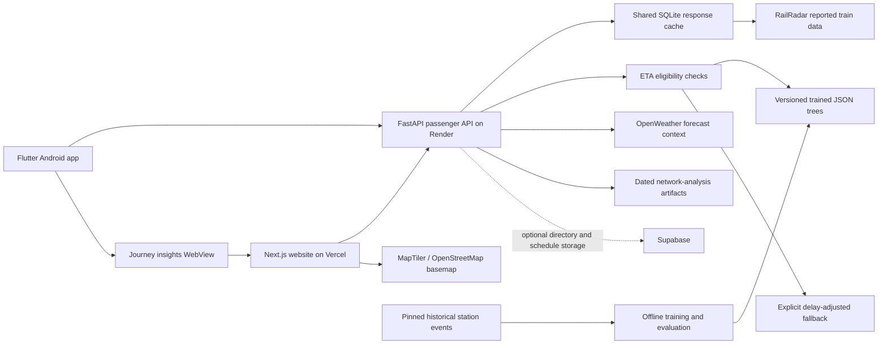

| Layer | Actual implementation |
| --- | --- |
| Website | Next.js **16.3.4**, React **19.2.8**, TypeScript, Tailwind CSS 4, Leaflet |
| Mobile | Flutter **3.32+**, Dart **3.8.1+**, Riverpod 3, GoRouter, HTTP, SharedPreferences, WebView |
| API | Python, FastAPI, Pydantic, HTTPX, optional Supabase client |
| ETA | Offline scikit-learn training; portable JSON tree inference without a scikit-learn runtime dependency |
| Persistence | SQLite response cache and observation archive; optional Supabase directory/schedule path |
| Hosting | Vercel website, Render API, locally built Android APK |

[Runtime architecture and trust boundaries](docs/architecture/system-architecture.md)

## Run it locally

Prerequisites: Git, Python **3.11+** (3.12 recommended), Node.js **20.9+** and
npm; Flutter **3.32+** with Dart **3.8.1+** and Android tooling for mobile.
Follow the lockfiles rather than upgrading dependencies during setup.

```bash
git clone https://github.com/Vivek-Biswal/SIH_ETA.git
cd SIH_ETA
```

**Terminal 1 — API:**

```bash
cd backend
python -m venv .venv
# macOS/Linux: source .venv/bin/activate
# PowerShell: .\.venv\Scripts\Activate.ps1
python -m pip install -r requirements.txt
cp .env.example .env
# Set your server-side RAILRADAR_API_KEY in backend/.env for live train data.
python -m uvicorn main:app --reload --port 8000
```

**Terminal 2 — website:**

```bash
cd apps/web/web_app
npm ci
cp .env.example .env.local
# Set NEXT_PUBLIC_API_BASE_URL=http://localhost:8000/api/v1
npm run dev
```

Open [the local website](http://localhost:3000/dashboard) and
[API documentation](http://localhost:8000/docs). In PowerShell, `Copy-Item` can
replace `cp`. The backend reads `.env` from its working directory; the root
environment file is only an index of subsystem configuration.

**Flutter — Android emulator:**

First configure the local Android signing properties required by the current
Gradle project; see [Flutter setup](docs/development/setup.md#flutter).

```bash
cd apps/mobile/flutter_app
flutter pub get
flutter run --dart-define=API_BASE_URL=http://10.0.2.2:8000
```

The mobile define is the backend **root**, while the website variable includes
`/api/v1`. Private provider keys never belong in either client. No database or
retraining is required to start the API with its checked-in model; meaningful
running data does require a configured source.

For platform-specific setup, checks, optional database configuration and common
errors, use the [complete setup guide](docs/development/setup.md).

## Demo, deployment and mobile installation

| Component | Entry point | Verified on 17 October 2026 |
| --- | --- | --- |
| Website | [Etaernal dashboard](https://equinox01.vercel.app/dashboard) | Public interface loaded; genuine gallery captures obtained. |
| Backend | [Health endpoint](https://sih-eta-backend-a819.onrender.com/health) | Returned `healthy`; provider availability is a separate concern. |
| API explorer | [Swagger UI](https://sih-eta-backend-a819.onrender.com/docs) | Runtime API entry point. |
| ETA model | [Model diagnostic](https://sih-eta-backend-a819.onrender.com/api/v1/eta/model) | Returned `validated_pilot`, enabled, three supported trains. |
| Android | [Build/install instructions](docs/v1_deployment_guide.md#android-apk) | Source version **1.1.11+13**; gallery captures 1.1.9+11. No public APK release URL is currently published. |

The Render free service may need time to wake. Responses can be cached or
unavailable if the upstream allocation is exhausted. MapTiler depends on a valid
domain-authorized browser key; the application falls back visibly to
OpenStreetMap. See [deployment configuration](docs/v1_deployment_guide.md).

## Project structure

```text
SIH_ETA/
├── apps/
│   ├── web/web_app/           # Next.js website and focused Node tests
│   └── mobile/flutter_app/    # Native Flutter screens and shared web workspace
├── backend/
│   ├── api/                  # Routes, controllers and runtime OpenAPI
│   ├── services/             # Provider cache, ETA inference, reasons and weather
│   ├── repositories/         # Optional Supabase data access
│   ├── data/eta_ml/           # Versioned model, evaluation and split manifest
│   └── tests/                # Provider, inference, explanation and API tests
├── intelligence/
│   ├── train_eta/            # Pinned importer, training and policy audit
│   └── network_intelligence/ # Historical railway-analysis work
├── data/                     # Samples/schemas; raw and processed data are ignored
├── docs/                     # Current guides, evidence index and genuine screenshots
├── shared/                   # Shared schemas and the original API proposal
└── .github/                  # CI, issue forms and pull-request guidance
```

## Roadmap

- [x] Shared passenger API, website and Flutter train search/arrival screens.
- [x] Station-specific explanations with measured and estimated recovery separated.
- [x] Trained three-train pilot, chronological validation and baseline comparison.
- [x] Selected-route maps, journey analytics, historical insights and what-if simulation.
- [x] Shared provider cache, duplicate-request suppression and quota backoff.
- [ ] Collect durable production observations and verify ETA performance prospectively.
- [ ] Expand representative train/route coverage without weakening model eligibility checks.
- [ ] Evaluate better in-transit features and reliable weather/operational data when available.
- [ ] Add drift monitoring, periodic evaluation and a reviewed retraining process.
- [ ] Finish production authorization, data-licence review and signed public mobile releases.

## Contribution, licence and credits

Start with [CONTRIBUTING.md](CONTRIBUTING.md). Report reproducible bugs through
[GitHub Issues](https://github.com/Vivek-Biswal/SIH_ETA/issues); include the train,
journey date, station and sanitized evidence. Never attach credentials or real
environment files. See [SECURITY.md](SECURITY.md) for sensitive reports.

**No project software licence has been selected.** Public source availability
does not imply unrestricted reuse. Dataset licences and provider terms are
separate; read [data sources and attribution](docs/DATA_SOURCES.md).

Acknowledgements: the Etaernal contributors; the SIH Ministry of Railways problem
statement; RailRadar; OpenWeather; MapTiler; OpenStreetMap contributors; the
historical dataset publisher **yadavsaurabh**; and the open-source frameworks
used by the project. These acknowledgements do not imply endorsement.
