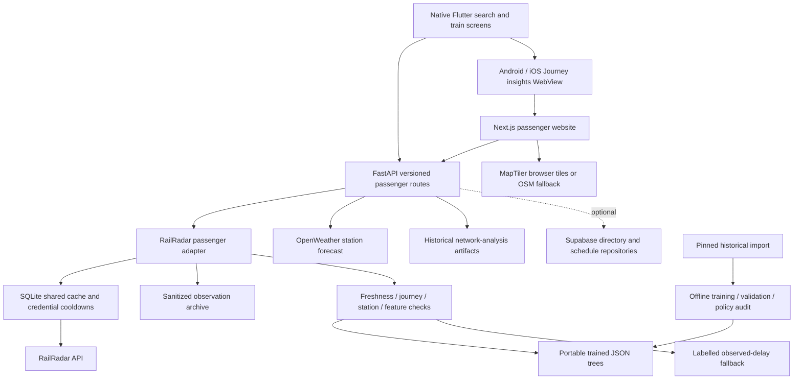

# Runtime architecture

Audited on 17 October 2026. This describes implemented paths; the original
database, authentication and operational-control proposals are not assumed live.

## Client responsibilities

**Website:** `apps/web/web_app/src/services/passenger.ts` normalizes status and
ETA, checks train/journey identity and preserves source/method/freshness. Map
components display one selected train. Coordinate resolution may use station
locations and approximate links; it does not establish surveyed railway geometry.
Simulation and analytics are separate from the live prediction pipeline.

**Flutter:** `core/services/train_repository.dart` adapts the same passenger
responses for native search/details. Local preferences hold onboarding, appearance
and saved journeys. `journey_workspace_screen.dart` embeds the deployed workspace
and handles sanitized CSV sharing. Full Journey insights parity is shared web
functionality, not four independent native reimplementations.

## Backend responsibilities

- `api/routes/trains.py`: selected journey status, per-stop ETA and weather.
- `services/railradar_passenger.py`: provider adaptation, timestamps, confirmed
  events, freshness and route-order constraints.
- `services/railradar_requests.py`: shared SQLite responses, same-request locking,
  date aliases, ordered authorized-key failover and retry cooldowns. Default live
  cache is 120 seconds; directory lookups cache for a day and other schedule
  requests for six hours. Stale fallback is bounded and identified.
- `services/eta_ml.py`: eligible inference using a versioned JSON model. CPU
  inference runs outside the asynchronous API event loop.
- `services/arrival_reasons.py`: per-stop passenger copy and evidence-backed
  delay/recovery fields; no unsupported physical cause is invented.
- `services/weather_service.py`: selected-station forecast context, separate from
  trained delay prediction.
- `services/eta_observations.py`: sanitized observations from successful fetches,
  without extra upstream polling. SQLite storage is not automatically durable
  on an ephemeral hosting filesystem.
- `services/adapters/network_adapter.py`: dated historical analysis, not a feed
  of live nationwide track occupancy.

## ETA decision boundary

The checked-in artifact is a trained three-train station-event pilot. For each
target stop, inference requires a supported train/station pair, fresh running
evidence, a recent confirmed event, consistent provider delay and in-range
features/horizon. Exceptional, stale or unsupported journeys decline trained-model inference.

The fallback is **scheduled arrival + latest reported delay**, clearly labelled.
No fresh running evidence means timetable/unavailable behavior rather than a
fabricated live forecast. Stops may use different methods in the same response;
the per-stop method is authoritative. Route-order adjustments can withhold a
future-recovery claim. See [the complete model audit](../ETA_MODEL_AUDIT.md).

## Storage, deployment and security boundaries

The current backend uses Supabase's Python client for optional directory/schedule
repositories. It does not require the SQLAlchemy/PostgreSQL/Redis/Alembic stack
described in early proposals. Demo Supabase defaults select an in-memory client;
passenger-facing code must not pass sample data off as observed railway data.

Private RailRadar, weather and Supabase service-role keys remain in the API
environment. MapTiler browser keys are necessarily delivered to map clients and
must be domain-restricted. No enforced universal JWT authentication should be
inferred from the login UI or original YAML specification.

The website is hosted on Vercel and API on Render. Native Flutter calls the API;
its Journey insights WebView additionally depends on the hosted website. Polling
and shared caching provide updates; the passenger dashboard does not require the
legacy WebSocket telemetry endpoint.

## Separate research and compatibility paths

Earlier notebooks, model wrappers, `/api/*` scenario endpoints and dashboard
sample summaries still exist. They are not evidence for the production ETA
pipeline. The unchanged shared YAML and older design documents must be treated
as proposals unless reconciled with runtime OpenAPI and route code.

[API guide](../api/api-contract.md) · [Feature status](../FEATURE_STATUS.md) ·
[Deployment](../v1_deployment_guide.md)
