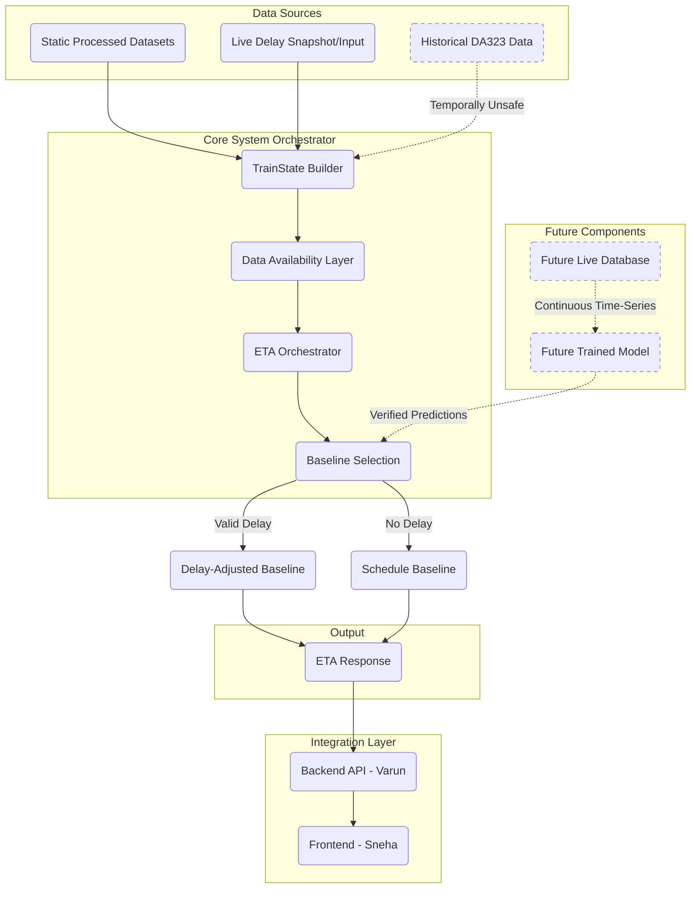

# Final System Data Flow

> Historical preparation snapshot. Statements about data availability,
> implementation and next steps describe the `railway_eta_data` preparation
> stage. For the current trained pilot and application status, see the
> [model audit](../../docs/ETA_MODEL_AUDIT.md) and
> [feature status](../../docs/FEATURE_STATUS.md).

This document visualizes the data flow for the Group A ETA prediction system.

## Key Points:
1. **Historical DA323 Data** is parsed and available in the `TrainState` but is explicitly bypassed by the ETA Orchestrator during baseline calculation to prevent data leakage.
2. The **Baseline Selection** is strictly deterministic, choosing between schedule-only or current-delay-adjusted.
3. The system explicitly plans for **Future Components** (predictive modeling and Live DB) which are currently missing.
